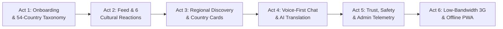

# AfriLink Investor & Stakeholder Demonstration Guide

**AfriLink: The Sovereign Pan-African Social & Professional Network**  
**Version:** 2.0 Afro-Futurist Redesign  
**Demo Duration:** 5–7 Minutes  
**Audience:** Venture Capital Investors, Pan-African Trade Delegates, Telecom Partners  

---

## Executive Overview
AfriLink is the first social and professional networking platform engineered specifically for the infrastructure realities of the African continent. Combining an Afro-Futurist design language (Sahara Gold, Deep Forest Emerald, and Dark Slate) with an ultra-lightweight frontend architecture, AfriLink delivers real-time connection, regional trade discovery, voice-first messaging, and AI translation across all **54 African sovereign nations**—even over constrained **2G/3G cellular networks**.

---

## Demonstration Setup & Environment Configuration

### 1. Pre-Demo Checklist
- [ ] Run production build locally: `npm run build && npm run start` (or access staging: `https://afrilink.africa`)
- [ ] Browser: Google Chrome or Chromium-based browser with DevTools accessible
- [ ] Audio: Ensure microphone access is permitted for voice recording and speakers/headphones are active
- [ ] Network Emulation: Open Chrome DevTools (`F12`), navigate to **Network** tab, locate the Throttling dropdown (default: *No throttling*)

### 2. Demo Persona & Credentials
- **Username:** `@kwame_accra` (Kwame Mensah, Verified Pan-African Tech Entrepreneur)
- **Native Language:** Yoruba (`yo`) / English (`en`)
- **Location:** Accra, Ghana (West Africa)

---

## 5-Minute Investor Demo Script (6 Acts)

---

### Act 1: Pan-African Onboarding & 54-Country Taxonomy Showcase
**Route:** `/onboarding` | **Duration:** 45 seconds

#### What to Show:
1. Navigate to `/onboarding` (or `/register`).
2. Show the **Pan-African Taxonomy Selector**:
   - Scroll through the 54 sovereign African nations categorized across **West Africa (16)**, **East Africa (15)**, **Southern Africa (10)**, **North Africa (5)**, and **Central Africa (8)**.
   - Select **Ghana** (`GH`) or **Nigeria** (`NG`). Observe how the native language dropdown immediately adapts to feature the country’s primary indigenous and national languages (e.g., Akan, Ewe, Ga for Ghana; Yoruba, Hausa, Igbo for Nigeria).
3. Select Pan-African interest tracks: *Agritech Innovation*, *Afrobeats & Creative Economy*, *Cross-Border Trade*, *Renewable Energy*.
4. Highlight the **User Avatar**: Notice that before an image is even uploaded, a deterministic Afro-Futurist HSL gradient with two-letter typography appears instantly—zero network overhead.

> **Investor Talking Point:**  
> *"Existing Western social networks treat Africa as a monolith with localized English/French overlays. AfriLink’s taxonomy models all 54 sovereign states, their geopolitical trade blocs, and 160+ regional languages from the very first onboarding click."*

---

### Act 2: Pan-African Feed, 6 African Reactions & 1-Tier Comments
**Route:** `/` | **Duration:** 60 seconds

#### What to Show:
1. Navigate to Home Feed (`/`).
2. Show the category navigation pills: **For Africa**, **Friends**, **Communities**, **Photos & Video**.
3. Point out the **African Cultural Reaction Archetypes** on any post card:
   - Tap and hold or hover over the reaction trigger to display the 6 authentic African reactions:
     1. **Resonate (🤝):** Solidarity, agreement, pan-African unity.
     2. **Celebrate (🥁):** Drum of celebration, milestone, joy.
     3. **Ubuntu (🫂):** *"I am because we are"*—community humanity and shared responsibility.
     4. **Support (✊):** Uplift, economic empowerment, resilience.
     5. **Insight (🏺):** Calabash of ancient and modern wisdom.
     6. **Fire (🔥):** Viral energy and momentum.
   - Click a reaction and highlight the GPU-safe spring micro-interaction (scale 1.5→1 spring) without jank.
4. Expand the **1-Tier Comment System**:
   - Post a root comment and a nested reply.
   - Point out the **Strict Depth Guard**: AfriLink intentionally caps nested replies at 1 tier. This eliminates horizontal layout crushing on sub-\$100 Android smartphones with narrow 360px viewport widths.

> **Investor Talking Point:**  
> *"We replaced generic Silicon Valley 'likes' with cultural archetypes that reflect African relational dynamics. Furthermore, our 1-tier comment hierarchy ensures readability on 99% of Android devices across the continent."*

---

### Act 3: Regional Discovery Track & Typographic Shorthand Cards
**Route:** `/discover` | **Duration:** 45 seconds

#### What to Show:
1. Navigate to `/discover` (or press keyboard shortcut `G` then `D`).
2. Demonstrate the **Horizontal Regional Navigation Track**:
   - Smoothly scroll the pill bar: **All 5 Regions (54)** | **West Africa (16)** | **East Africa (15)** | **Southern Africa (10)** | **North Africa (5)** | **Central Africa (8)**.
   - Note the **trailing 24px gradient overflow mask** that visually communicates horizontal scrollability without bulky scrollbars.
   - Click an active tab: Notice the clean, deep emerald fill (`bg-emerald-600`) with soft emerald glow, completely free of aggressive gold border noise.
3. Review the **Typographic Country Cards**:
   - Each card displays high-contrast typography, official ISO country codes, calling codes, regional badges, and creator count indicators.
   - Point out that **zero external image assets or flag libraries** are downloaded—keeping route chunks ultra-light.

> **Investor Talking Point:**  
> *"Regional cross-border commerce under the African Continental Free Trade Area (AfCFTA) requires discovering business partners by region and country. Our discovery engine provides instant filtering with near-zero data usage."*

---

### Act 4: Local Language Voice Messaging & AI Translation Interface
**Route:** `/messages` | **Duration:** 60 seconds

#### What to Show:
1. Navigate to `/messages` (or press `Cmd/Ctrl+M`).
2. Show the two-column workspace (conversation list on left, thread stream on right).
3. Demonstrate **Voice-First Messaging**:
   - In Africa, voice notes are the primary communication medium due to multilingual keyboards and oral storytelling cultures.
   - Click the microphone icon in the composer.
   - Observe the recording console: pulsing recording indicator, live duration counter, and dynamic audio waveform bars.
   - Send the voice note. Observe the custom **AudioPlayer** bubble with playback waveform and fallback Web Speech synthesis.
4. Demonstrate **AI Cross-Language Translation**:
   - Locate a message written in an African indigenous language (e.g., Yoruba: *"Báwo ni nǹkan ṣe ń lọ ní Èkó?"*).
   - Click the **Translate** badge next to the message.
   - The message smoothly reveals the real-time translation (English: *"How are things going in Lagos?"*) with an attribution tag indicating source language and model confidence.

> **Investor Talking Point:**  
> *"Language fragmentation is Africa's biggest barrier to cross-border collaboration. With native voice-first recording and embedded neural translation between indigenous African languages and international trade tongues, AfriLink connects people who couldn't previously converse."*

---

### Act 5: Trust & Safety Center, Moderation & Admin Command Center
**Route:** `/admin` | **Duration:** 45 seconds

#### What to Show:
1. Click the verified user badge check: Notice the inline `BadgeCheck` icon beside verified creators, certifying business and creator identities across borders.
2. Demonstrate the **Abuse Reporting Dialogue**:
   - In any chat or post menu, click **Report**.
   - Select standard categories: *Misinformation, Hate Speech, Impersonation, Scams, Harassment*.
   - Submit report; observe instant optimistic toast feedback.
3. Open the **Admin Command Center** at `/admin`:
   - Highlight the **Real-Time Pan-African Telemetry Dashboard**:
     - Active users distributed across West, East, Southern, Central, and North Africa.
     - Moderation review queue with pending flags and one-click actioning (Approve, Dismiss, Ban).
     - System latency and WebSocket gateway uptime metrics.

> **Investor Talking Point:**  
> *"Safety and anti-fraud infrastructure are essential for pan-African digital trust. AfriLink combines proactive user-level reporting with a centralized operational command center designed for rapid compliance."*

---

### Act 6: Low-Bandwidth Network Resilience & Offline PWA Capabilities
**Duration:** 60 seconds

#### What to Show:
1. **Simulate 3G Network Throttling**:
   - In Chrome DevTools, open the **Network** tab.
   - Set throttling to **Slow 3G** (400 Kbps downlink, 400ms RTT) or **Fast 3G** (1.6 Mbps downlink, 150ms RTT).
   - Hard refresh (`Ctrl+F5` or `Cmd+Shift+R`) on `/` or `/discover`.
   - **Observe Skeleton Placeholders:**
     - `FeedPostSkeleton` and `CountryCardSkeleton` render immediately without Cumulative Layout Shift (CLS).
     - Text and layout structures do not jump when data hydrates.
   - **Observe UserAvatar Fallback:**
     - Avatars paint their deterministic gradient and initials in 0 milliseconds before remote profile pictures finish downloading.
2. **Dynamic Chunk Lazy-Loading**:
   - While in Network tab, trigger **Cmd/Ctrl+K** (Search Modal) or click the emoji picker.
   - Point out that `GlobalSearchModal`, `EmojiPicker`, and `VoiceRecorder` are lazy-loaded on-demand—never bloating the initial critical bundle.
   - Confirm that the shared First Load JS is just **~105 KB** gzipped (well under the 150 KB ceiling).
3. **Offline PWA Simulation**:
   - In DevTools Network tab, switch throttling to **Offline**.
   - Navigate between tabs (Home, Discover, Communities).
   - Point out that the Service Worker (`public/sw.js` powered by Workbox) serves cached navigation shells, fonts, and assets seamlessly without an offline browser crash screen.
4. **Keyboard Shortcuts**:
   - Press `?` to summon the keyboard shortcuts reference sheet.
   - Press `Cmd/Ctrl+K` to search across 54 countries and communities.
   - Type in an input box: observe that shortcuts never fire inadvertently while typing.

> **Investor Talking Point:**  
> *"Data costs in Sub-Saharan Africa are among the highest in the world relative to income. While our competitors require 5 to 10 MB per page load, AfriLink loads in ~105 KB, works offline via PWA caching, and feels instant even on a 3G mobile hotspot in rural Ghana or Kenya."*

---

## Technical Architecture Reference Card

| Dimension | Specification | Verification Metric |
| :--- | :--- | :--- |
| **Shared First Load JS** | Next.js 15 App Router | **105 kB gzipped** (Budget: $\le 150\text{ kB}$) |
| **All Route Chunks** | Code-split dynamic imports | **All 14 routes $\le 267\text{ kB}$ initial** |
| **Unit Test Coverage** | Node.js native test runner | **323+ tests passing, 0 failures** |
| **Real-Time Connectivity** | WebSocket Gateway + Backoff | **1s, 2s, 4s, 8s, max 10s + 10s REST polling** |
| **Network Envelope** | Strict API Response contract | `{ data, meta, error }` with offline recovery |
| **A11y Standard** | WCAG 2.1 AA | **100% of icon controls have explicit `aria-label`** |
| **Offline Capability** | Service Worker / PWA | **Full navigation chrome cache via Workbox** |
| **Motion Safety** | `useSafeMotion` hook | **Zero animation duration on `prefers-reduced-motion`** |

---

## Frequently Asked Investor Questions (FAQ)

**Q: How does AfriLink keep data consumption so low for African consumers?**  
*A: We apply a strict "Phase 0 Performance Guard": No raster flag images, no heavy font weights, dynamic code-splitting for heavy modals (`{ ssr: false }`), CSS-only animated waveforms and avatars, and strict bundle size enforcement during production builds.*

**Q: What happens when cellular connectivity is spotty or drops completely?**  
*A: The WebSocket client auto-reconnects with exponential backoff and transparently triggers a 10-second REST polling fallback. If the network drops entirely, the Workbox Service Worker caches navigation chrome and cached posts so the user never sees a blank offline error.*

**Q: Why a 1-tier comment hierarchy instead of infinite Reddit-style nesting?**  
*A: On entry-level Android devices with 360px viewport widths, 3+ levels of nesting compress text into 1-word columns that are unreadable. Our 1-tier hierarchy maximizes screen real estate and ensures democratic conversation readability across all price tiers of devices.*
